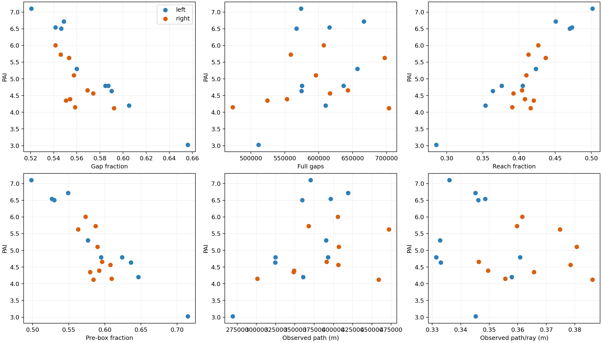
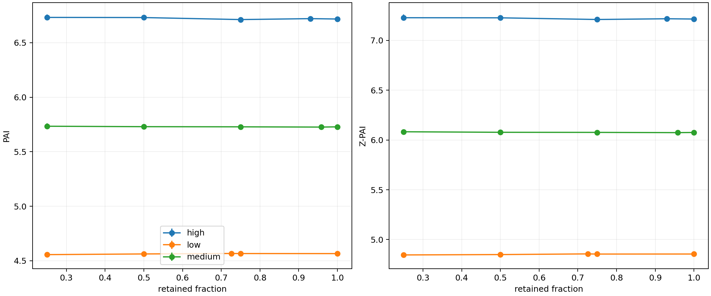
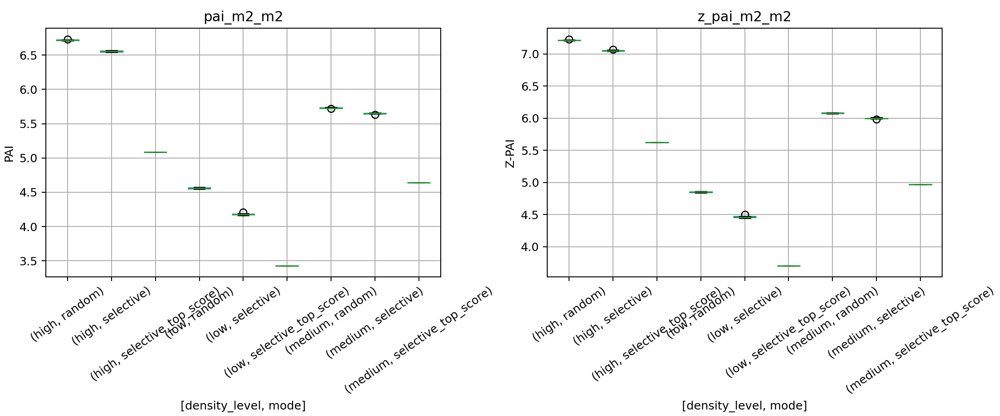
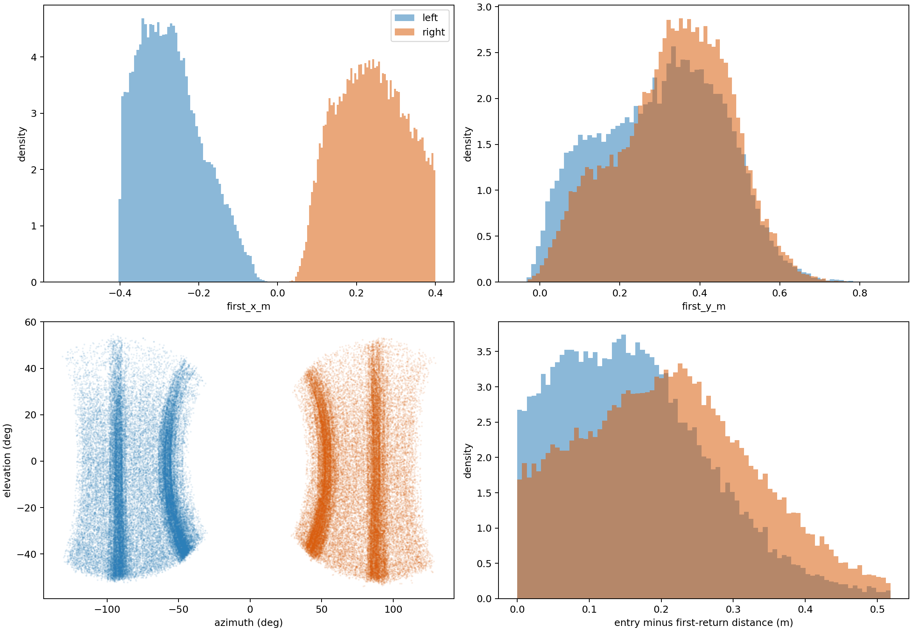
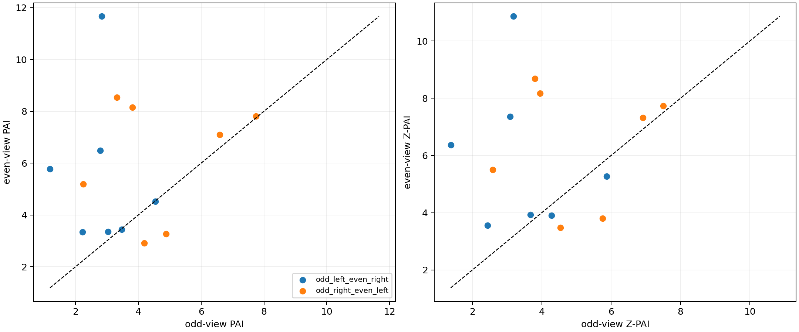

# PAI / Z-PAI side-bias diagnostic audit

Date: 2026-09-17

Data: `/media/central/raw_mirror/al_lai/density_test`

Scope: 10 replacement raw scans, 20 left/right scan sides

## Bottom line

The strongest evidence places the large side dependence at **first-return censoring immediately before the ray box**, not at emitted-ray count, left/right box geometry, IMU/local-ground correction, or a sign-asymmetric likelihood implementation.

The two sides receive the same scan-level ray pool and have nearly equal numbers of rays intersecting their mirrored boxes, but they retain different angular/spatial mixtures after a first return occurs before the near box face. Those pre-box rays do not enter either likelihood directly. Their removal changes which rays, chords, gaps, and first-event paths remain, and that selection produces large PAI/Z-PAI changes. Randomly removing the same number of rays does not.

This dataset does **not** show numerical saturation or loss of support at its observed PAI range. It also has no independent true-density measurement, so it cannot establish a regime in which true density rises while estimated PAI plateaus or falls.

## Scope and data integrity

- I restarted the audit from the replacement data and reconstructed all ten scans with the production pipeline functions.
- Reconstructed first-event counts and PAI/Z-PAI values matched the current `results.csv` and current summary diagnostics.
- `ray_box_diagnostics.csv` contains older appended records. The audit selected the 20 current `(scan_name, side)` keys and used 458 current rows: 20 summaries, 219 PAI layers, and 219 Z-PAI layers. It excluded 2,352 stale rows.
- `generate_pointclouds` is disabled, so there are no saved processed point-cloud files. The audit used the exact in-memory `AnalysisTarget.current_points` produced by the normal point-processing path.
- The audit harness reuses production reconstruction, first-event classification, PAI, and Z-PAI functions. It does not alter their implementation. Seeded stochastic tests use seed `20260917`.

Supporting metadata: [metadata.json](metadata.json), [audit.py](audit.py), [processing.log](processing.log).

## A. Where the bias enters

The first large likelihood-relevant divergence appears at **pre-box classification / reach**, after ray-box intersection geometry has remained close. A processed-point asymmetry appears earlier in the spatial pipeline, but the scan-level emitted-ray pool is balanced.

The table reports the median absolute paired difference, normalized by the pair mean, across the ten scan-level left/right pairs.

| Processing stage | Metric | Median absolute paired difference |
|---|---:|---:|
| Raw acquisition | total rays supplied to each side | 0.000% |
| Raw acquisition | valid returns supplied to each side | 0.000% |
| Raw acquisition, native beam direction | positive-vs-negative ray count | 0.007% mean |
| Raw acquisition, native beam direction | positive-vs-negative valid-return count | 1.29% mean; sign alternates by scan |
| Point processing | processed side points | 15.09% |
| Box geometry | intersecting rays | 2.22% |
| First-event selection | hits before box | 12.06% |
| First-event selection | pre-box fraction | 9.70% |
| First-event selection | observed rays | 11.16% |
| First-event selection | reach fraction | 13.02% |
| Observation mixture | full gaps | 9.86% |
| Observation mixture | within-box hits | 14.77% |
| Observation mixture | gap fraction | 5.31% |
| Path geometry after selection | mean chord | 4.41% |
| Path geometry after selection | median chord | 10.57% |
| Path geometry after selection | total geometric chord | 14.31% |
| Path geometry after selection | total observed path | 14.10% |
| Path geometry after selection | observed path/ray | 6.22% |
| Estimate | PAI | **32.64%** |
| Estimate | Z-PAI | **26.85%** |

The equal scan-level totals occur because both sides are evaluated from the same raw scan interval. An independent split by native beam direction confirms that the sensor emitted essentially equal positive- and negative-X ray counts. Valid-return imbalance is modest and alternates with snake direction, unlike a fixed sensor-side defect.

Across the 20 sides, paired PAI differences track paired Z-PAI differences (Spearman ρ = 0.988), pre-box fraction (ρ = -0.976), reach fraction (ρ = 0.976), processed points (ρ = 0.952), and total geometric chord (ρ = 0.952). The association does not alone prove causality, but it locates the dominant split in the first-event survival/composition chain.

Full data: [side_differences.csv](side_differences.csv), [raw_acquisition_by_direction.csv](raw_acquisition_by_direction.csv), [summary_metrics.csv](summary_metrics.csv).



### Strongest individual example: scan 008

| Metric | Left | Right |
|---|---:|---:|
| Intersecting rays | 2,196,593 | 2,168,604 |
| Hits before box | 1,094,785 | 1,321,390 |
| Pre-box fraction | 0.4984 | 0.6093 |
| Observed rays | 1,101,808 | 847,214 |
| Reach fraction | 0.5016 | 0.3907 |
| Gap fraction | 0.5208 | 0.5584 |
| PAI | **7.1029** | **4.1550** |
| Z-PAI | **7.4969** | **4.5436** |

Only 1.28% separates the intersection counts, but the right side has 226,605 more pre-box hits and 23.1% fewer observed rays. Its PAI is 41.5% lower and Z-PAI is 39.4% lower.

## Bookkeeping and likelihood membership

For every one of the 20 current summary records, the following identities hold exactly, with zero maximum integer error:

```text
intersecting = before-box + observed + unknown
observed     = within-box hit + full gap
```

All 20 PAI and Z-PAI summaries have `unknown = 0`. Therefore the proposed numerical identity `observed = hit + gap + unknown` also happens to hold here, but it is not the implementation's semantic definition: `unknown` is explicitly outside `observed`.

The classifier defines `before`, `hit`, `gap`, `observed = hit | gap`, and the remaining intersecting rays as `unknown` in [`mta.py`, lines 136-160](../../../lidar_analysis/mta.py#L136). Only hits and gaps receive a nonzero observed path.

PAI then selects `chord[observed]` and `gaps[observed]` before fitting in [`pai.py`, lines 317-346](../../../lidar_analysis/pai.py#L317). Its negative log-likelihood is

```text
sum(eta for gaps) - sum(log(1 - exp(-eta)) for hits), eta = G * PAD * chord
```

as implemented in [`pai.py`, lines 47-62](../../../lidar_analysis/pai.py#L47). Z-PAI uses the same first-event classes, sums path only for `observed`, and estimates each layer from `hits / (G * exposure)` in [`pai.py`, lines 151-245](../../../lidar_analysis/pai.py#L151).

No before-box count, before-box range, side label, or X sign occurs in either objective.

## B. Can lower ray count alone explain the bias?

No. I subsampled representative richer-observed sides at 75%, 50%, and 25%, plus approximately the observed-ray count of the poorer side, with ten seeded repeats per level. Even at 25% retention, mean bias stayed within 0.22% for both estimators.

| Pair-density level | Representative | Baseline PAI / Z-PAI | PAI bias at 25% | PAI SD | Z-PAI bias at 25% | Z-PAI SD |
|---|---|---:|---:|---:|---:|---:|
| Low | scan 001 right | 4.565 / 4.855 | -0.205% | 0.018 | -0.188% | 0.017 |
| Medium | scan 005 right | 5.728 / 6.076 | +0.097% | 0.027 | +0.115% | 0.024 |
| High | scan 004 left | 6.718 / 7.214 | +0.220% | 0.026 | +0.183% | 0.032 |

This amount of random removal mainly adds small variance because the original samples contain roughly one million observed rays per side. It does not reproduce the actual 16-34% representative side differences.

Full data: [random_subsampling.csv](random_subsampling.csv).



## C. Are hits before the box directly or indirectly responsible?

**Indirectly.** The code proof above shows that before-box rays are counted for diagnostics but excluded from both objectives. They matter by changing the composition of the surviving observations.

To test that mechanism, I removed the same number of observed rays from the richer side in three ways:

- uniformly at random;
- sampled with propensity based on the poorer side's before-box distribution in azimuth, elevation, entry distance, and chord;
- the highest-scoring rays under that propensity model, an intentionally strong sensitivity bound.

| Density level | Random removal PAI / Z-PAI bias | Propensity-weighted PAI / Z-PAI bias | Highest-propensity PAI / Z-PAI bias | Actual poorer-vs-richer PAI / Z-PAI difference |
|---|---:|---:|---:|---:|
| Low, scan 001 | -0.10% / -0.09% | -8.44% / -8.04% | -24.89% / -23.71% | -33.8% / -26.7% |
| Medium, scan 005 | +0.02% / +0.03% | -1.41% / -1.28% | -18.96% / -18.21% | -16.4% / -12.7% |
| High, scan 004 | -0.00% / +0.01% | -2.46% / -2.27% | -24.33% / -22.08% | -30.7% / -28.4% |

The propensity model is deliberately coarse, so it is not expected to reproduce every observed pair. The controlled result is nonetheless decisive: **count-matched random loss is neutral, while composition-dependent loss is systematically downward and can become large.**

Full data: [selective_censoring.csv](selective_censoring.csv).



### Where the rejected first returns occur

Across scan sides:

| Spatial diagnostic | Left mean | Right mean |
|---|---:|---:|
| Median distance before entry | 0.190 m | 0.205 m |
| Mean 5th-95th percentile span | 0.028-0.411 m | 0.029-0.421 m |
| Entry occurs at near X face | 99.989% | 99.990% |
| First return lies within box Y/Z projection | 99.985% | 99.988% |
| First return is within 0.5 m of entry | 98.493% | 98.337% |
| All three conditions | 98.481% | 98.328% |
| Median first-return X | -0.249 m | +0.237 m |
| Median first-return Y | 0.333 m | 0.339 m |

The nominal near faces are X = -0.4 m and +0.4 m. Thus almost all rejected returns are in the central excluded `|X| < 0.4 m` slab, aligned with the box in Y and Z, and only a few decimetres before entry. This is spatially consistent with nearby crop/canopy or row material, not distant random clutter.

For scan 008, the right side's 1,321,390 pre-box returns have median entry shortfall 0.207 m; 97.99% satisfy all three near-face tests. The left side has 1,094,785 pre-box returns, median shortfall 0.153 m, and 99.32% satisfy them.

Full summary and sampled rejected rays: [prebox_spatial_summary.csv](prebox_spatial_summary.csv), [prebox_ray_sample.csv](prebox_ray_sample.csv).



## D. Does high PAI create saturation or identifiability failure here?

No evidence of that failure appears in these replacement scans:

- Whole-box gap fractions range from 0.5208 to 0.6559, with 473,118-703,502 full gaps per side. They are nowhere near zero.
- The smallest conditional-layer gap fraction is 0.1287 (scan 008 left, 0.0-0.1 m), still 8,058 gaps among 62,596 observed rays.
- All 20 summaries have `pai_saturated = false` and `pai_converged = true`.
- All 219 conditional-layer fits have `all_hits = false` and `converged = true`.
- All 20 Z-PAI profiles are complete with support fraction 1.0.
- The 25% random subsamples remain stable even for the high representative.

The reported `pai_profile_converged = false`, `pai_profile_identifiable = false`, and NaN condition/singular-value fields do **not** indicate a failed fit in this run. They describe the optional joint profile, which was not run. The production runner hard-codes the separate conditional profile on, while the joint profile remains config-controlled in [`central_runner.py`, lines 434-448](../../../lidar_analysis/central_runner.py#L434).

The available scans do not provide an independent true canopy-density ordering. Consequently, the requested biological plateau/reversal test is not identifiable from these data alone; scan-to-scan PAI itself cannot be used as both truth and response.

## E. Physical Row-2 opposite-view test

I reconstructed marker windows for odd scans 1-7 and even scans 7-1, then tested both possible side assignments without using treatment labels.

| Assignment | Processed points | Intersecting rays | Pre-box fraction | Reach fraction | Gap fraction | Mean chord | Observed path/ray | PAI | Z-PAI |
|---|---:|---:|---:|---:|---:|---:|---:|---:|---:|
| odd right ↔ even left | 17.14% | 12.33% | 25.54% | 68.83% | 3.81% | 10.38% | 5.27% | **39.49%** | **41.06%** |
| odd left ↔ even right | 67.56% | 13.10% | 14.52% | 42.78% | 17.47% | 22.69% | 39.75% | **40.20%** | **37.46%** |

Values are median absolute pair-relative differences across the seven specified physical positions. The first assignment is more internally plausible because its point count, gap fraction, and path/ray agree better, but field orientation is not independently established, so both are retained.

Yes: physical opposite views still disagree substantially. Under the more plausible first assignment, position 1↔7 agrees well (PAI 7.748 vs 7.807), while 3↔5 (2.247 vs 5.186), 5↔3 (3.315 vs 8.539), and 6↔2 (3.808 vs 8.146) do not. This rules out treatment-label assignment as the sole explanation, but it does not by itself distinguish true marker-window misregistration from view-dependent first-return censoring.

Full data: [row2_marker_metrics.csv](row2_marker_metrics.csv), [row2_opposite_view_pairs.csv](row2_opposite_view_pairs.csv).



## F. Source and geometry findings

### Geometry is symmetric where expected

- Left X bounds are `[-1.5, -0.4] m`; right bounds are `[+0.4, +1.5] m`. Both widths are 1.1 m.
- A synthetic mirrored-ray test produced identical intersection masks and exactly zero maximum entry/exit-distance difference.
- The fixed LiDAR mounting translation has X offset 0; ray origins and directions use the same `ZXY` rotation as point reconstruction in [`pipeline_core.py`, lines 695-772](../../../lidar_analysis/pipeline_core.py#L695).
- Side bounds are simple mirrored branches in [`pipeline_core.py`, lines 775-799](../../../lidar_analysis/pipeline_core.py#L775).
- Current local-ground reference is exactly 0.0 m on all 20 sides.
- Disabling IMU/heading and local-ground correction for scan 008 leaves the split nearly unchanged: PAI 6.952 vs 4.142 and Z-PAI 7.373 vs 4.571. The normal run was PAI 7.103 vs 4.155 and Z-PAI 7.497 vs 4.544.

Supporting data: [geometry_checks.json](geometry_checks.json), [scan08_noimu_global_ground.csv](scan08_noimu_global_ground.csv).

### Suspicious implementation/reporting details

1. **The public PAI is the integrated conditional-layer estimate, not the whole-box MLE.** The whole-box fit is initially saved separately, then `pai_m2_m2` is overwritten by the sum of conditional layer fits in [`pai.py`, lines 398-466](../../../lidar_analysis/pai.py#L398). In these scans, whole-box PAI is 1.50-2.14 while reported conditional PAI is 3.02-7.10. That may be intended, but the naming makes the distinction easy to miss.
2. **The conditional profile is always enabled by the production runner.** `pai_run_conditional_profile=True` is hard-coded. Each layer reclassifies all box-intersecting rays against that layer; a first return below an upper layer censors the ray from that layer. This is a plausible amplifier of view-dependent first-return selection.
3. **Joint-profile QC fields are misleading when the joint fit is disabled.** False/NaN defaults can look like a convergence or identifiability failure even though that estimator was never attempted.
4. **Box height is estimated separately from each side's processed points.** This allows small left/right differences in Y maximum and layer count. It is a controlled-geometry sensitivity worth testing, although it cannot explain the large scan-008 split by itself.
5. **No asymmetric likelihood bug was found.** I found no side label, X sign, asymmetric clip, direction reversal, entry normalization, or side-specific likelihood term in the PAI/Z-PAI source. The transmission likelihood and Z-PAI exposure estimator are internally consistent for the rays they receive.

## G. Ranked hypotheses

1. **Selective pre-box censoring by nearby canopy/row material** — strongest support. The rejected returns are overwhelmingly just inside the excluded central slab; paired PAI follows pre-box/reach changes; selective but not random removal lowers both estimates.
2. **Conditional layer-by-layer reclassification amplifies that selection** — strong code/mechanism support. Surviving angular/path mixtures differ by view, and upper layers condition on first returns below them.
3. **Processed spatial-crop/marker-window differences change both the point-derived height and the ray survival mixture** — moderate support. Processed point counts diverge before likelihood classification, and opposite-view marker pairs remain inconsistent.
4. **Residual path/chord composition differences after censoring** — moderate support as a mediator, not an independent root cause. Mean chord differences are modest, but total chord/path differ because different rays survive.
5. **Raw acquisition, IMU/ground transforms, high-PAI saturation, or a left/right sign bug** — low support in this dataset. Directional acquisition is close, the scan-008 control preserves the bias, gaps remain abundant, fits converge, and mirrored geometry/source inspection is symmetric.

## H. Smallest controlled follow-up experiments

These are proposed experiments only; none changes production behavior in this audit.

1. **Near-face sweep:** rerun a few worst pairs with `pai_x_near_m` at 0.0, 0.1, 0.2, 0.3, and 0.4 m. Plot paired PAI against pre-box fraction. A shrinking side difference as the central exclusion shrinks would directly implicate near-face canopy censoring.
2. **Matched-ray cohort:** within azimuth/elevation/entry/chord bins, retain an identical balanced distribution on both sides and recompute PAI/Z-PAI. This separates canopy response from view-dependent sampling composition without changing the likelihood.
3. **Fixed shared box:** for each paired view, force the same X width, Z interval, ground, Y maximum, and layer edges. This isolates the small side-specific height/layer effect from first-event selection.
4. **Estimator reporting control:** calculate whole-box PAI, conditional PAI, Z-PAI, and an enabled joint profile side-by-side for the same fixed cohort. This tests whether conditional reclassification is the main amplifier and supplies real joint identifiability diagnostics.
5. **Static opposite-view acquisition:** scan one marked physical Row-2 window from both directions without changing marker boundaries, speed, or box coordinates. This is the cleanest discriminator between biological/registration differences and direction-dependent occlusion/censoring.

## Reproduction and artifacts

The completed replacement-data run used:

```bash
python3 docs/diagnostics/pai_side_bias_2026-09-17/audit.py \
  > docs/diagnostics/pai_side_bias_2026-09-17/processing.log 2>&1
```

Primary artifacts:

- [summary_metrics.csv](summary_metrics.csv)
- [side_differences.csv](side_differences.csv)
- [prebox_spatial_summary.csv](prebox_spatial_summary.csv)
- [prebox_ray_sample.csv](prebox_ray_sample.csv)
- [random_subsampling.csv](random_subsampling.csv)
- [selective_censoring.csv](selective_censoring.csv)
- [row2_marker_metrics.csv](row2_marker_metrics.csv)
- [row2_opposite_view_pairs.csv](row2_opposite_view_pairs.csv)
- [scan08_noimu_global_ground.csv](scan08_noimu_global_ground.csv)
- [geometry_checks.json](geometry_checks.json)

No production algorithm, configuration, or source file was modified.
